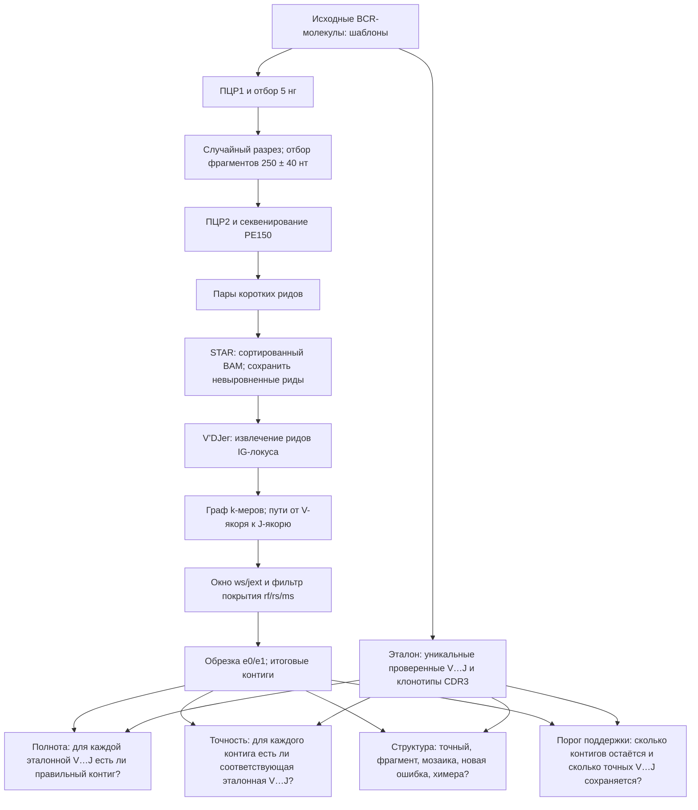

# V’DJer: схема пилота и словарь метрик

Этот документ относится к [основному отчёту](run2_base_report.md), [таблицам полных прогонов](README.md)
и сохранённым [пилотам](pilots.tsv). Цель настройки V’DJer — получить **правильную полную V…J и CDR3**,
а не просто файл с контигами. Источник входных требований и sensitive mode —
[официальный репозиторий V’DJer](https://github.com/mozack/vdjer).

## Слова без жаргона

| Термин | Что означает здесь |
|---|---|
| **п.п.** | Процентный пункт: разница между двумя долями в процентах. 27,35% − 22,65% = **4,70 п.п.** Это не относительный прирост 4,70%; он равен примерно 20,8% от исходных 22,65%. |
| **шаблон** | Исходная последовательность молекулы BCR, с которой симулятор создаёт копии и фрагменты. Для оценки одинаковые V…J одного образца объединены в *уникальную V…J*; она считается проверенной, если есть независимая поддержка исходных данных по правилу отчёта. |
| **рид** | Прочитанный секвенатором короткий участок фрагмента. Пара PE150 — два рида с противоположных концов одного фрагмента. |
| **сборка** | Процесс соединения частично перекрывающихся ридов в более длинную последовательность. Слово иногда обозначает и результат работы программы. |
| **контиг** | Одна длинная последовательность на выходе сборщика. Контиг может быть точным, неполным, ошибочным или химерным; само его наличие не означает успеха. |
| **порог** | Число, при котором принимают решение: например, оставить контиги с поддержкой ≥3 ридов или признать выравнивание близким при покрытии ≥95% и идентичности ≥98%. Порог меняет компромисс между полнотой и шумом. |
| **поддержка** | Сколько наблюдений свидетельствуют в пользу контига. У TRUST4 это `consensus_count` приписанных ридов; у SPAdes — среднее k-мерное покрытие `cov`; это разные величины, напрямую их сравнивать нельзя. |
| **эталон / truth** | Известные последовательности до симулированного секвенирования. С ним сравнивают выход сборщика; программа сама его при работе не видит. |
| **V…J** | Участок рецептора от V до конца J, который здесь нужно восстановить целиком. **CDR3/junction** — меньший, особенно изменчивый участок вблизи стыка V(D)J; наличие CDR3 ещё не означает точности всей V…J. |

## Топология: от молекулы до двух разных видов оценки

**Главное различие знаменателей:** полнота делит число восстановленных **эталонных V…J** на число всех
проверенных эталонных V…J; точность и структура делят классы **выданных контигов** на число контигов.
Один эталон может совпасть с несколькими контигами; один контиг может покрывать только часть эталона.

## Как читать каждую таблицу основного отчёта

| Раздел/таблица | Каждая метрика и её знаменатель | Как связана с соседними |
|---|---|---|
| **0. Формулы, классы полноты** | `exact_full`: вся V…J входит в контиг без отличий; `one_diff_full`: вся V…J восстановлена с одним отличием; `near_full`: ≥95% длины и ≥98% идентичности; `partial`: есть более слабое выравнивание; `missing`: нет выравнивания. Каждый эталон получает один класс; доли суммируются до 100%. | Показывает потери эталонов, но не число лишних контигов. `exact_full` — первичная цель пилота. |
| **0. Формулы, классы точности** | `exact_full`: контиг содержит проверенную V…J; `near_full`: почти целая правильная V…J; `correct_partial`: правильный участок ≥100 нт, но не почти полный; `unverified_match`: похож на непроверенный эталон; `incorrect`: выравнивание есть, но оно плохое; `unmapped`: не найдено. Знаменатель — все контиги. | Успех по полноте может сосуществовать с большим числом ошибочных контигов. |
| **0. Формулы, структура контига** | `exact_verified`: целая проверенная V…J; `exact_unverified`: целая непроверенная V…J; `exact_fragment`: безошибочный кусок; `mosaic`: варианты оснований взяты из разных проверенных шаблонов; `unverified_variant`: так же, но с непроверенными; `novel_error`: отличие не объясняется эталонами; `chimera`: концы от разных эталонов; `other`: выравнивание не подходит ни под эти классы; `unmapped`: нет выравнивания. Знаменатель — контиги. | Уточняет природу ошибок из таблицы точности. `exact_fragment` означает правильный кусок, но не решение задачи полной V…J. |
| **1. Полнота** | Число и доля проверенных V…J в пяти классах выше, отдельно по виду и сборщику. Разрезы `копий 1 / 2–4 / 5+` — частота исходной V…J; `IGH/IGK/IGL` — цепь; `read_overlap`, `mate_linked_only`, `unlinked`, `partial_read_coverage`, `no_reads` — насколько исходные риды вообще связывают V с J. | Сравнивает инструменты при одинаковом эталоне и показывает, является ли потеря следствием данных или алгоритма. `no_reads` — отрицательный контроль. |
| **2. CDR3** | `клонотипов` — число разных сочетаний образец+цепь+junction; `найден` — сколько из этих junction встретились в каком-либо контиге; доля = найдено/все клонотипы. Контроль — клонотипы без ридов. | CDR3 может быть найден даже в контиге с неверной остальной V…J: высокая доля CDR3 не заменяет `exact_full`. |
| **3. Точность** | `контигов` — весь выход сборщика; остальные строки — числа и доли шести классов точности из раздела 0. | Смотрит в обратную сторону от раздела 1: «какая часть ответа надёжна?». |
| **4. Структура** | Числа и доли девяти классов структуры из раздела 0. | Различает точный кусок, мозаику, новую ошибку и химеру, которые могут оказаться рядом в упрощённой таблице точности. |
| **5. Поддержка** | В строках `1`, `2–4`, `5–9`, `10–49`, `50+` — число контигов с таким `consensus_count` и доля структурных классов *внутри строки*. В таблице `≥τ`: `осталось` = число контигов после фильтра; `exact recall` = число/доля эталонов, для которых остался хотя бы один точный контиг; `novel_error` = доля ошибок среди оставшихся. | Хороший порог сокращает шум, почти не теряя точные эталоны. `consensus_count` — не число независимых молекул. |
| **5а. Режимы SPAdes** | `контигов`, медиана длины (50-й процентиль), пять классов полноты, доля CDR3 и классы структуры. Знаменатель полноты — 1 766 эталонных V…J ERR346600, структуры — контиги каждого режима. | Короткие `exact_fragment` могут выглядеть хорошими локально, но не повышают полную V…J. |
| **8. Проверка метрик** | Числа вида `совпало/проверено` — размер проверенной выборки и число согласий между независимыми способами расчёта, а не биологическая точность сборщика. | Это контроль правильности оценщика. |
| **9. База против хвостов** | `точно` — число и доля `exact_full`; `partial` — число и доля неполных; позиции начала/конца фрагментов и доля пар, связывающих V с CDR3, объясняют изменение. | Показывает, что падение точной сборки при хвостах связано прежде всего с исчезновением физической связи между частями молекулы. |
| **10. Сравнимость** | `templates_whole_vj` считает каждый исходный шаблон и всю V…J; `unique_vj_trim20` объединяет одинаковые V…J и удаляет 20 нт праймерной зоны мыши; `unique_vj_trim0` у человека не удаляет их. | Нельзя сравнивать доли с разными знаменателями и трактовкой 5′-края как прямое улучшение сборщика. |

## Что значат столбцы сохранённых TSV

- `full_runs_summary.tsv`: `run/date/dataset/branch/scoring/tool` — происхождение результата;
  `group_by/group` — разрез (образец, цепь, копии и т. п.); `templates` — знаменатель полноты;
  пять `*_frac` — доли классов полноты, `cdr3_in_contig_frac` — доля найденных CDR3.
- `full_runs_precision.tsv`: те же поля происхождения, `sample`, `contigs` — знаменатель точности;
  `exact_full_frac`, `near_full_frac`, `correct_partial_frac`, `incorrect_frac`, `unmapped_frac`,
  `unverified_match_frac` — классы точности; `structure_*_frac` — девять классов структуры.
- `full_runs_structure.tsv`: `support_type` — тип поддержки (риды TRUST4 либо покрытие SPAdes);
  `support_bin` — диапазон поддержки; `contigs` и девять классов структуры — абсолютные числа внутри диапазона;
  `table=support_thresholds`, `min_support`, `contigs_kept`, `verified_exact_recall` — результат применения порога.
- `pilots.tsv`: `pilot` — название эксперимента; `condition` — конкретный режим/путь; `metric` — измеряемая
  величина; `value` — её значение; `source` — первичная сохранённая сводка. Доли и абсолютные числа в этой
  длинной таблице различаются по названию `metric` — всегда проверять единицы и знаменатель.

## База и `tails_c1400`

В обеих ветках используются те же исходные BCR-шаблоны и схема: ПЦР1 → порция продукта 5 нг → один случайный
разрез → отбор фрагментов 250 ± 40 нт → ПЦР2 → NovaSeq PE150. **Базовая ветка** не добавляет к продукту ПЦР1
длинные технические хвосты. **`tails_c1400`** добавляет хвосты праймеров ПЦР1: 58 нт с 5′-конца и 68 нт
с 3′-конца (суммарно 126 нт); разброс эффективности ПЦР1 задаётся распределением Beta с концентрацией
`c=1400`, откалиброванной по UMI человека. Это название параметра модели, а не число ридов или молекул.

Фрагменты после отбора остаются примерно той же длины. Хвосты занимают в них место, где в базе лежала
биологическая V…J. Поэтому меньше пар одновременно видят далёкую V-часть и CDR3: на ERR346600 в отчёте
24,6% пар в базе против 1,9% на хвостах. TRUST4 на всех образцах восстанавливает точно 54,8%→18,2% V…J
мыши и 31,8%→14,5% человека. Это сравнение веток симуляции; оно не показывает, что один режим V’DJer уже
настроен. Для пилота V’DJer базу и хвосты нужно оценивать отдельно и одинаковой схемой `scoring`.

## Пилот V’DJer: что считать успешным

1. Сначала на официальном демо подтвердить работоспособность бинарника и референсов.
2. На наших данных отдельно выбрать один образец мыши IGH и одну цепь человека. Вход: симулированные пары
   FASTQ, STAR BAM на соответствующем геноме, сортировка/индекс, сохранённые unmapped reads.
3. Зафиксировать версии исходников, референса и точные параметры. `MIN_CONTIG_SIZE`, `ws`, `jext`, `e0/e1`,
   `rf`, `rs`, `ms`, `ins` менять только в отдельных вариантах; не подбирать по итоговой тестовой выборке.
4. Для каждого варианта измерять последовательно: контиги и их длину → присутствие CDR3 в **самой
   последовательности** → `exact_full`/`near_full` по V…J → ошибки и шум. Выход `rf=0` считать только
   диагностикой: он не прошёл фильтр покрытия.
5. Переносить удачный режим на полный набор только если он улучшает восстановление целой V…J и не порождает
   неприемлемое число ложных контигов. Наличие ненулевого `vdj_contigs.fa` для этого недостаточно.

Последние сохранённые пилоты: усечённое окно IGL дало 827 контигов длиной 258 нт, но 0/5 090 CDR3;
полное 384-nt окно дало 1 992 контига и 27/5 090 CDR3. При работающем фильтре покрытия несколько
человеческих и мышиных вариантов дали 0 контигов. Это результаты из сохранённого `pilots.tsv`, а не
результат нового локального пилота.
